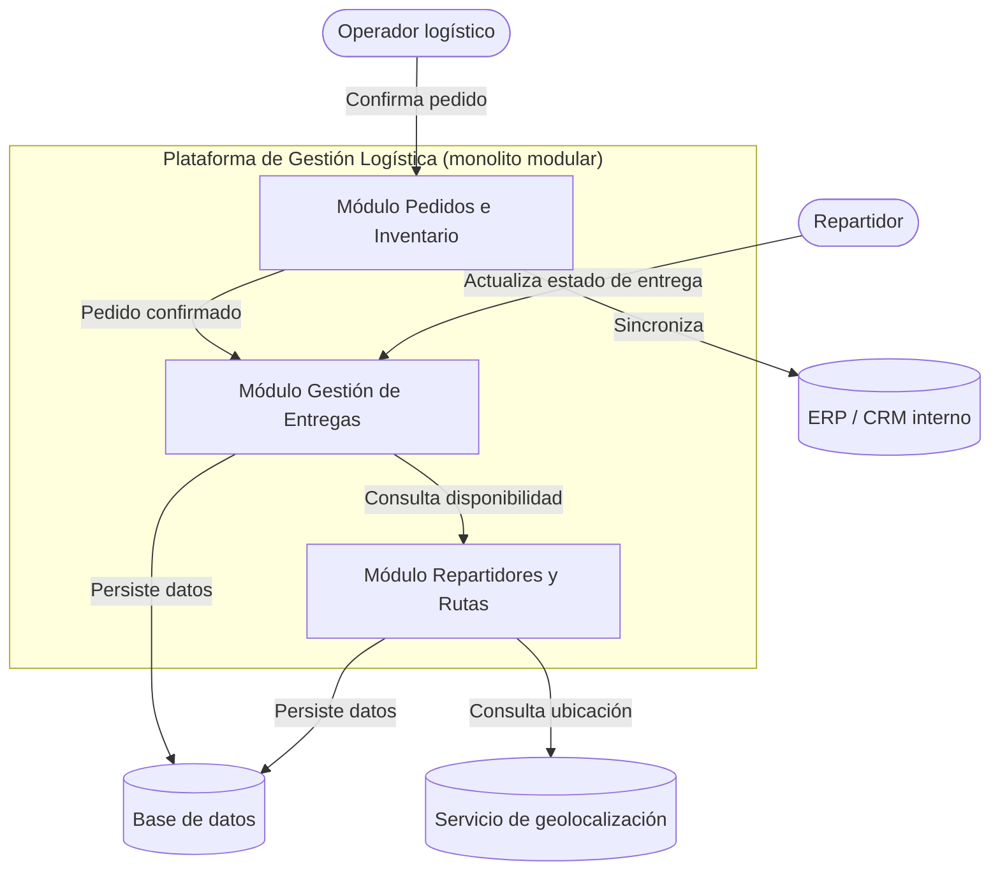
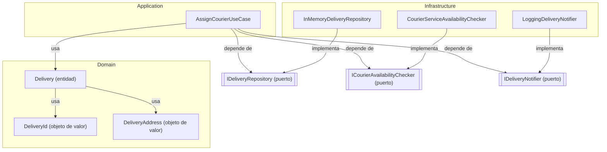

# Diagrama C4: Contenedores y Componentes

## Nivel 2: Diagrama de contenedores

Muestra las grandes piezas de la plataforma y cómo se relacionan, ampliando el diagrama de
contexto de la Actividad 1 con un nivel más de detalle.

## Nivel 3: Diagrama de componentes (flujo "Asignar repartidor a una entrega")

Muestra el detalle interno del módulo de Entregas para el flujo modelado en esta actividad,
siguiendo la separación Domain / Application / Infrastructure.

## Lectura de los diagramas

- En el diagrama de contenedores, el **monolito modular** (decisión de la Actividad 2) se
  representa como una sola plataforma con tres módulos internos, cada uno con su
  responsabilidad, consistente con los bounded contexts definidos en este documento.
- En el diagrama de componentes, se evidencia la **dirección de las dependencias**: tanto
  `Infrastructure` como `Application` apuntan hacia los puertos y hacia `Domain`, pero
  `Domain` no depende de ninguno de los dos. Esto protege la lógica de negocio de los
  detalles técnicos, tal como exige la actividad.
